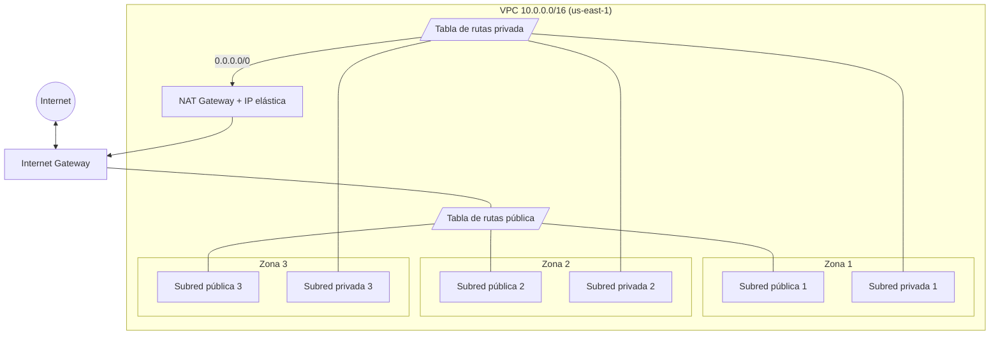

# Actividad 1.1: De la consola a Terraform

Esta actividad tiene dos partes que construyen **la misma red en AWS**, pero de dos formas distintas. La idea es vivir en carne propia la diferencia entre hacerlo a mano y hacerlo con código.

- [Parte I: Creando infraestructura en la nube (manual)](parte-1-manual/README.md). Guía 1.1.1, 2 horas, grupal.
- [Parte II: Integrando Terraform en el mundo empresarial](parte-2-terraform/README.md). Guía 1.1.2, 3 horas, individual.

## Qué se construye

En ambas partes se arma una red privada (VPC) en la región `us-east-1`, repartida en tres zonas de disponibilidad. Cada zona tiene una subred pública y una privada. Las subredes públicas salen a Internet por un **Internet Gateway**, y las privadas salen por un **NAT Gateway** que vive en una subred pública.

## Una analogía para entender la red

Piensa en la VPC como un **condominio cerrado**. Las subredes son los pasajes dentro del condominio. Los pasajes públicos tienen salida directa a la calle por el portón principal (el **Internet Gateway**). Los pasajes privados no tienen salida propia: si alguien de ahí necesita salir, pasa por una **conserjería** (el **NAT Gateway**), que le abre la puerta para salir, pero no deja que desconocidos de la calle entren directo a esos pasajes. Las **tablas de rutas** son los letreros que indican por dónde se sale en cada pasaje.

## La conclusión de la actividad

En la Parte I se necesitan decenas de clics, se escriben nombres y rangos de IP a mano y es fácil equivocarse. En la Parte II, Terraform crea los mismos 18 recursos con un solo comando, en el orden correcto, y los borra todos con otro comando sin dejar nada olvidado. Si hubiera que montar esta red diez veces, la diferencia sería enorme.
